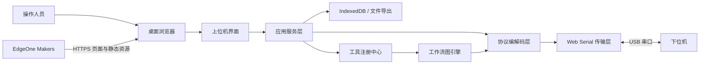

# 系统架构

## 1. 目标与边界

PC Toolbox 定位为可扩展 Web 工具平台。EdgeOne Makers 负责构建和分发静态页面，浏览器负责工具界面、串口访问、工作流执行、协议处理及本地数据保存。

系统不包含常驻云端连接服务，不将原始串口数据自动上传到服务器，也不承诺页面关闭后的后台采集能力。

## 2. 上下文架构



EdgeOne 只分发应用。`navigator.serial` 在用户浏览器进程中执行，串口权限也由用户浏览器管理。

## 3. 前端分层

### 3.1 表现层

负责串口配置、收发控制台、统计、图表和错误反馈。组件不得直接持有 `SerialPort`，也不得自行解析二进制协议。

### 3.2 应用服务层

协调连接、断开、发送、日志记录和协议消息。它消费抽象传输层，因此同一套 UI 可以使用真实串口或模拟传输。

### 3.3 协议层

负责字节流缓冲、帧边界识别、校验、编码与业务消息映射。通用串口终端模式允许原始字节直接进入显示层；设备专用模式必须经过协议解码器。

### 3.4 传输层

定义统一接口：

```ts
export interface DeviceTransport {
  readonly state: TransportState;
  connect(options: SerialConnectionOptions): Promise<void>;
  disconnect(): Promise<void>;
  write(data: Uint8Array): Promise<void>;
  subscribe(listener: (chunk: Uint8Array) => void): () => void;
}
```

计划实现：

- `WebSerialTransport`：生产环境连接真实串口。
- `MockTransport`：开发、演示和自动化测试。

### 3.5 持久化层

用户配置和有限历史记录保存在 IndexedDB；少量 UI 偏好可以保存在 `localStorage`。大日志采用流式导出，避免长期占用浏览器存储。

## 4. 数据流

### 接收

```text
SerialPort.readable
  -> Uint8Array 数据块
  -> 可选的帧解码器
  -> 领域消息或原始记录
  -> 状态仓库
  -> 控制台 / 图表 / 本地日志
```

一次 `read()` 返回的是任意长度的数据块，不等于一个协议帧。协议层必须能够处理半包、粘包和多个帧连续到达。

### 发送

```text
用户输入或预设命令
  -> 参数验证
  -> 协议编码器
  -> Uint8Array
  -> 串行写入队列
  -> SerialPort.writable
```

所有写入通过单一队列执行，防止定时发送和手动发送交叉写入。

## 5. 非功能性要求

- 稳定性：重复连接、设备拔出和读取异常后必须回到可恢复状态。
- 性能：UI 不为每个字节单独更新；接收记录批量提交并限制内存条数。
- 隐私：默认不上传串口内容。
- 安全：不自动执行页面加载前保存的危险命令；连接与首次发送需要明确用户操作。
- 可测试性：协议层使用纯函数，传输层可以被 Mock 替换。
- 可观测性：错误包含阶段、原始异常和面向用户的解决建议。

## 6. 未来演进

需要无人值守、浏览器外驱动、CAN 或远程控制时，新增本地 Agent 和云端实时服务。现有传输接口可以增加 `AgentWebSocketTransport`，无需重写协议和 UI 层。

工具平台与工作流的模块边界、注册规范和执行规则详见[工具平台与工作流架构](workflow-architecture.md)。
