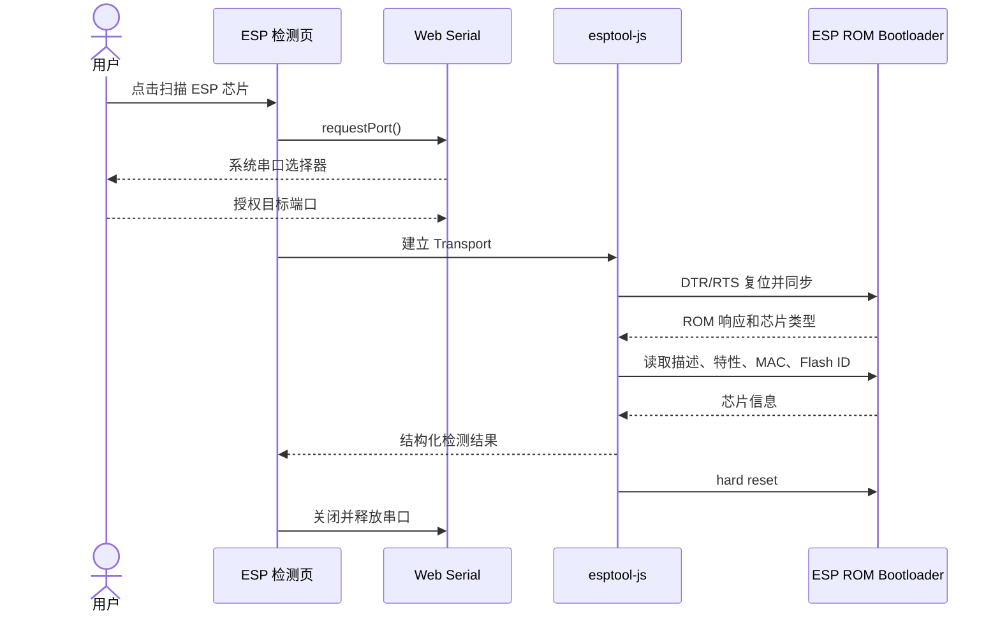

# ESP 芯片检测

## 1. 功能范围

ESP 芯片检测工具通过 Web Serial 和 Espressif 官方 `esptool-js` 与芯片 ROM Bootloader 通信。当前功能是只读识别，不包含固件烧录、Flash 擦除、eFuse 写入或安全配置修改。

可读取的信息取决于目标芯片，统一结果包括：

- 芯片系列名称和详细描述。
- 芯片 Revision（目标支持时）。
- 芯片特性列表。
- 晶振频率。
- 基础 MAC 地址。
- SPI Flash JEDEC ID、制造商 ID、设备 ID 和推断容量。
- 浏览器提供的 USB VID/PID，以及据此推断的 USB-UART/原生 USB 通讯方式。
- 处理器架构、封装、无线与存储能力、Flash 地址范围等自动解析结果。
- 包含原始数据和解析说明的 Excel 检测报告。

除芯片名称和 ROM 目标描述外，Revision、特性、晶振、MAC、Flash ID 与容量均独立读取。某项命令失败不会给该字段填入猜测值或默认值：UI 和 Excel 会省略该字段，并在检测结果中记录失败原因；其他已经确认的数据仍然可以使用。

## 2. 支持模型

实际支持范围由项目锁定的 `esptool-js` 版本决定。当前使用 `esptool-js 0.6.0`，其目标模块包括 ESP8266、ESP32、ESP32-S2、ESP32-S3、ESP32-C2、ESP32-C3、ESP32-C5、ESP32-C6、ESP32-C61、ESP32-H2 和 ESP32-P4 等。

新芯片支持应通过升级官方依赖获得，不在项目中复制或修改芯片 ROM 定义。

## 3. 检测流程



检测按钮必须由用户点击，避免违反 Web Serial 的用户激活要求。

## 4. 串口占用规则

ESP 检测和普通串口终端不能同时打开同一物理端口：

- 串口终端已连接时，ESP 检测会拒绝启动并要求先断开。
- ESP 检测进行中时，重复检测会被拒绝。
- 检测完成或失败后均尝试复位设备并释放端口。
- 设备在检测过程中拔出时，清理失败不会覆盖原始错误。
- `esptool-js` 的芯片查询命令必须串行执行；禁止使用 `Promise.all` 并发读取，因为所有命令共享同一个 Web Serial reader/writer。

## 5. Bootloader 进入方式

大多数带自动下载电路的开发板可以由 DTR/RTS 自动进入 Bootloader。如果同步失败：

1. 关闭 Arduino IDE、PlatformIO 串口监视器等占用程序。
2. 使用支持数据传输的 USB 线。
3. 按住开发板 `BOOT` 键。
4. 点击“扫描 ESP 芯片”并选择串口。
5. 日志出现连接尝试后松开 `BOOT`。
6. 必要时在按住 `BOOT` 时短按 `RESET/EN`。

原生 USB、USB-Serial/JTAG 以及不同 USB-UART 芯片的复位行为可能不同，应以开发板原理图为准。

## 6. 通讯方式解析

检测结果展示从浏览器到芯片的完整链路：

`Web Serial API → USB-UART/原生 USB → 115200 Baud、8-N-1 → SLIP → ESP ROM Bootloader`

- 浏览器的 `SerialPort.getInfo()` 提供 USB Vendor ID 和 Product ID。
- 内置映射可识别常见 FTDI、CP210x、CH340/CH341、CH9102、PL2303 和 Espressif USB Serial/JTAG 系列。
- VID/PID 只能辅助判断桥接芯片系列，不能可靠确定开发板品牌或每个兼容芯片的具体型号。
- 无法匹配时仍保留原始 VID/PID，并标记为未知桥接设备，不阻断芯片检测。
- ROM 命令使用 SLIP 帧传输；DTR/RTS 通常控制 BOOT 和 EN，具体连接由开发板电路决定。

## 7. JSON 与 Excel 报告

识别成功后可以导出结构化 JSON 或标准 `.xlsx`，全部在浏览器本地生成。JSON 中无法读取的字段为 `null`，并单独列出板级未知项，不使用默认开发板信息代替。

Excel 报告包括七个工作表：

1. `检测概览`：芯片、Flash、通讯方式和自动摘要。
2. `通讯链路`：浏览器 API、USB 桥、串口参数、ROM 协议和复位方式。
3. `特性解析`：无线、存储、Flash 地址范围和报告注意事项。
4. `eFuse安全状态`：导入的安全字段、Secure Boot、Flash Encryption及解析警告；不包含密钥块。
5. `PlatformIO推荐`：候选platform、board、framework、完整INI配置、推荐依据及风险提示。
6. `原始数据`：保留 `esptool-js` 返回值及对应读取 API；十六进制标识强制按文本保存，避免 Excel 自动改写。
7. `说明与来源`：安全边界、数据来源、解析限制和隐私提示。

工作簿由按需加载的 `exceljs` 在浏览器中创建，因此 Excel 依赖不会进入首屏主包。MAC 地址属于设备标识，对外发送报告前应按使用场景决定是否脱敏。

## 8. PlatformIO 配置推荐

检测完成后，页面根据芯片系列、实测Flash容量和可识别的PSRAM容量生成候选 `platformio.ini`。例如ESP8266且Flash为1MB时生成：

```ini
[env:esp01_1m]
platform = espressif8266
board = esp01_1m
framework = arduino
```

推荐规则只使用实际读取到的信息；Flash或PSRAM未读到时不会假定容量。ESP32-S3 N8R8会选择存储配置匹配的板型模板，ESP32、S2、C3和C6则选择对应芯片系列的官方通用开发板模板。未收录的新芯片不会生成虚假的board ID。

ROM Bootloader不能识别开发板品牌、PCB引脚布局、板载LED和外围器件，所以“芯片与存储匹配”不等于实际板型完全一致。烧录前仍应核对板卡丝印、原理图或卖家资料。页面会显示置信度、推荐依据和该限制，并提供PlatformIO官方板卡定义链接。

## 9. eFuse JSON 与安全状态

浏览器使用的 `esptool-js 0.6.0` 没有实现完整的 `espefuse summary` 字段表。页面不会仅根据芯片名称推测 Secure Boot 或 Flash Encryption。需要在安装了 Espressif 官方 esptool 的环境执行：

```powershell
espefuse --port COM5 --chip esp32s3 summary --format json --file efuses.json
```

将文件导入页面后，只保留允许列出的安全字段，例如 `SECURE_BOOT_EN`、`SPI_BOOT_CRYPT_CNT`、下载模式限制、JTAG限制、`SECURE_VERSION`和MAC。密钥块不会写入PC Toolbox报告。若JSON包含MAC，必须与本次ROM检测的MAC一致。

Flash Encryption状态按官方规则解析：`SPI_BOOT_CRYPT_CNT`中置位bit数量为奇数时启用；无法解析时保持未知。该入口只在完成芯片检测后以一行可选高级操作显示，不占用日常检测主流程。

## 10. 完整 Flash 备份（研究代码保留）

当前个人使用界面不提供Flash备份按钮，固件由用户使用自己的工具管理。仓库仍保留备份器研究代码，若未来作为独立高级工具启用，必须执行以下校验：

1. Flash容量必须来自本次实际检测，不能使用16MB等猜测默认值。
2. 重新连接后芯片型号必须一致。
3. ROM可读取MAC时，MAC必须与检测报告一致。
4. 从地址`0x00000000`读取检测到的完整容量。
5. 返回长度必须与预期字节数完全相同。
6. 浏览器计算SHA-256，并同时记录设备可返回的Flash MD5。
7. 下载`.bin`与只包含校验信息的`.manifest.json`。

备份是只读操作，不擦除、不写入Flash或eFuse。大容量Flash通过Web Serial读取可能需要较长时间，期间不可刷新页面或拔出USB。

## 11. 诊断固件模式（当前不在界面启用）

当前ESP页面不显示诊断模式、备份步骤、物理安全确认或烧录入口，也没有发布诊断固件二进制。相关设计和研究实现保留在仓库中，避免打扰日常检测，同时为后续独立高级工具保留演进基础。

固件与恢复流程必须满足[ESP诊断固件安全规范](esp-diagnostic-firmware.md)。必须先提供可审计源代码、固定ESP-IDF版本、构建产物哈希、适用芯片/Flash布局和JSON协议版本，才允许接入写入与恢复按钮。

## 12. 错误分类

| 现象 | 可能原因 | 处理建议 |
| --- | --- | --- |
| 用户取消 | 未选择串口 | 重新点击扫描 |
| 端口无法打开 | 被其他程序占用 | 关闭串口监视器或重插设备 |
| 无法同步 | 未进入 Bootloader | 使用 BOOT/RESET 手动进入下载模式 |
| Flash ID 异常 | 外部 Flash 连接或启动脚影响 | 移除相关外设并检查硬件 |
| 检测中断 | USB 线、电源或驱动不稳定 | 更换线缆或 USB 端口 |
| 自动复位失败 | 开发板复位电路不同 | 手动按 RESET/EN |

## 13. 工作流节点

`device.esp-detect` 节点执行相同检测流程，并输出 `EspChipInfo` 对象。由于调用 `requestPort()` 需要用户激活：

- 节点只适合由用户点击“运行工作流”后立即执行。
- 不应放在长延时或无人值守流程之后。
- 云端执行器无法访问现场浏览器串口。
- 后续本地 Agent 模式应提供无需浏览器权限弹窗的独立执行实现。

## 14. 安全边界

- 当前UI只暴露ROM只读检测、报告导出和可选eFuse JSON导入，不提供Flash备份、诊断固件写入或任何eFuse写入。
- 不允许把Secure Boot或Flash Encryption的未知状态当作“未启用”。
- eFuse JSON只提取安全白名单字段，不保存或导出密钥块。
- MAC 地址属于设备标识，默认只在本地显示，不上传云端。
- 日志不得包含未脱敏的安全密钥或 eFuse 密钥内容。
- 升级 `esptool-js` 时必须重新执行支持型号、复位和包体积测试。

## 15. 参考

- [Espressif esptool-js](https://github.com/espressif/esptool-js)
- [Espressif esptool 文档](https://docs.espressif.com/projects/esptool/en/latest/esp8266/index.html)
- [esptool 串行协议](https://docs.espressif.com/projects/esptool/en/latest/esp8266/advanced-topics/serial-protocol.html)
- [ESP32-S3 espefuse JSON summary](https://docs.espressif.com/projects/esptool/en/latest/esp32s3/espefuse/summary-cmd.html)
- [ESP32-S3 esptool 脚本接口与 read_flash](https://docs.espressif.com/projects/esptool/en/latest/esp32s3/esptool/scripting.html)
- [ESP32-S3 GPIO配置与保留引脚](https://docs.espressif.com/projects/esp-idf/en/stable/esp32s3/api-reference/peripherals/gpio.html)
- [PlatformIO ESP8266 ESP-01 1M](https://docs.platformio.org/en/latest/boards/espressif8266/esp01_1m.html)
- [PlatformIO Espressif 32 板卡目录](https://docs.platformio.org/en/latest/platforms/espressif32.html#boards)
