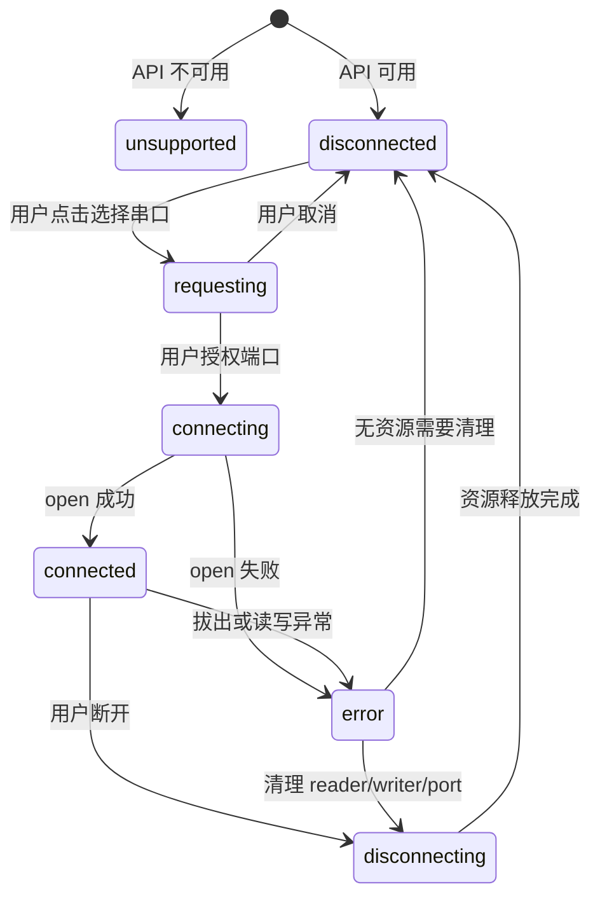

# Web Serial 核心设计

## 1. 浏览器能力检测

应用启动时检查：

```ts
const supported = "serial" in navigator;
const secure = window.isSecureContext;
```

不支持时保留 Mock 模式和文档入口，但禁用真实串口连接，并明确提示推荐浏览器与 HTTPS 要求。

## 2. 连接参数

第一阶段支持以下标准选项：

| 参数 | 默认值 | 可选值 |
| --- | --- | --- |
| 波特率 | 115200 | 常用值及正整数自定义 |
| 数据位 | 8 | 7、8 |
| 停止位 | 1 | 1、2 |
| 校验位 | none | none、even、odd |
| 流控 | none | none、hardware |

不把默认值视为下位机协议要求；真实参数确认后再提供设备预设。

## 3. 状态机



连接按钮只有在 `disconnected` 或可恢复的 `error` 状态可用。连接期间禁止重复调用 `requestPort()`。

## 4. 端口选择与授权

- 新端口使用 `navigator.serial.requestPort()`，必须位于用户点击事件的调用链内。
- 已授权端口可通过 `navigator.serial.getPorts()` 获取，但仍需用户明确点击后才打开。
- 如果已知 USB Vendor ID/Product ID，可以提供过滤器；未知时不设置过滤条件。
- 不保存或展示浏览器未提供的设备敏感标识。

## 5. 读取循环

读取循环遵循以下资源顺序：

1. 确认 `port.readable` 存在。
2. 获取 `reader` 锁。
3. 循环读取 `Uint8Array`。
4. 将数据块交给订阅者，不在传输层解释协议。
5. 捕获可恢复和不可恢复错误。
6. 在 `finally` 中释放 reader 锁。

断开时先取消 reader，使等待中的 `read()` 返回，再释放锁和关闭端口。禁止在 reader 仍锁定时调用 `port.close()`。

## 6. 写入队列

- 每个发送任务生成不可变 `Uint8Array`。
- 同一时刻只允许一个 writer 执行。
- 写入成功后更新发送字节数。
- 失败时记录原始错误，不把失败的数据计入已发送数量。
- 定时发送停止后清除计时器，不允许隐藏页面无限发送。

## 7. 设备插拔

监听 `navigator.serial` 的 `connect` 和 `disconnect` 事件。当前端口被拔出时：

- 立即停止定时发送。
- 终止读取循环。
- 将状态转为错误并执行资源清理。
- 保留已接收日志。
- 提示用户检查线缆和端口后重新连接。

第一阶段不默认无限自动重连。自动重连可能在设备身份不明确时连接错误设备，后续应结合 Vendor ID/Product ID 和产品需求再启用。

## 8. 显示与内存控制

- 接收数据按批次刷新 UI，而不是逐字节刷新。
- 内存中的控制台记录设置上限；超出后丢弃最旧的已显示项。
- 完整记录如有需要写入 IndexedDB，而不是全部保留在 React 状态中。
- HEX 显示使用两位大写字节，例如 `0A FF 1C`。
- 文本解码器默认 UTF-8，并允许后续增加 ASCII/GB18030。

## 9. 错误分类

| 类别 | 示例 | 用户处理建议 |
| --- | --- | --- |
| unsupported | 浏览器无 Serial API | 使用受支持的桌面浏览器 |
| insecure-context | 非 HTTPS 页面 | 改用 HTTPS 或 localhost |
| permission | 用户取消或拒绝 | 重新点击并选择端口 |
| open-failed | 端口被其他程序占用 | 关闭占用程序后重试 |
| read-failed | 设备拔出、驱动异常 | 检查设备并重新连接 |
| write-failed | 连接中断 | 停止发送并重新连接 |
| protocol | 帧长度或校验错误 | 检查协议参数和线路质量 |

日志保存技术错误信息，界面展示简洁的中文说明。

