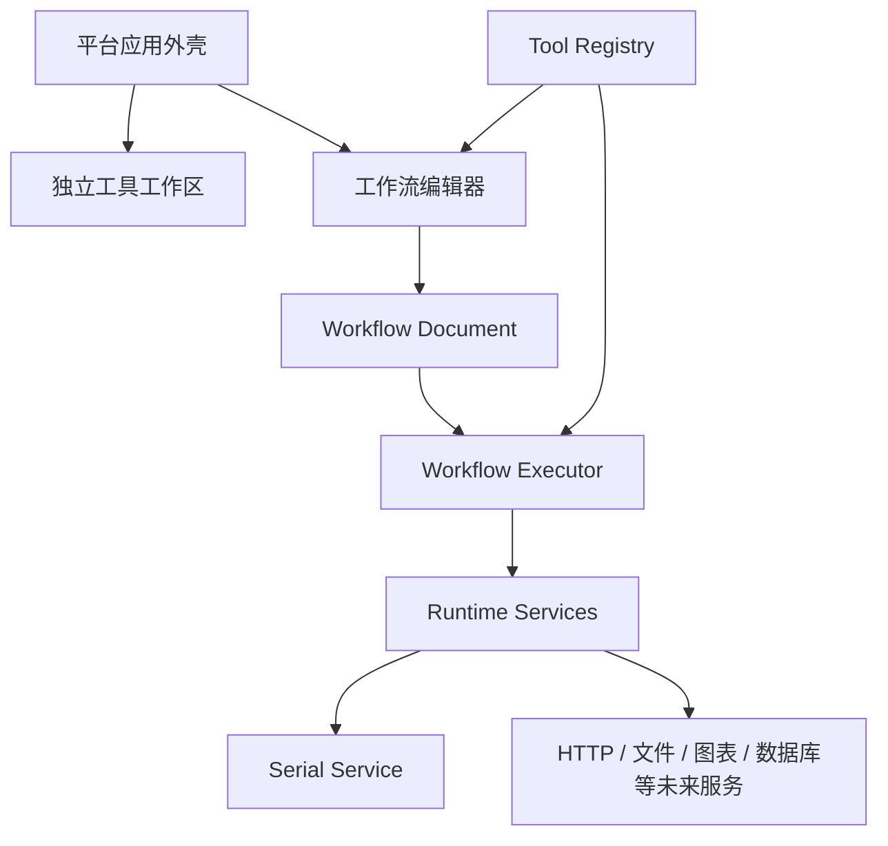

# 工具平台与工作流架构

## 1. 平台目标

PC Toolbox 不将串口功能写成不可复用的单体页面，而是将所有能力组织为“工具”。每个工具既可以提供独立工作区，也可以向工作流注册一个或多个节点。

新增工具的预期路径：

```text
实现工具能力
  -> 注册工具清单与节点执行器
  -> 自动进入工作流节点库
  -> 可被其他工具通过类型化端口连接
```

工作流编辑器不依赖串口、HTTP 或文件等具体实现。

## 2. 核心模块



### 工具注册中心

`ToolRegistry` 是节点能力的唯一目录。节点定义包含：

- 全局唯一 `type`。
- 所属工具 `toolId`。
- 名称、描述、分类、图标和颜色。
- 输入和输出端口及其数据类型。
- 配置字段 Schema。
- 可选执行器。

画布节点库、配置面板和执行引擎都读取同一个定义，避免三套配置漂移。

### 工作流文档

工作流使用版本化 JSON：

```ts
interface WorkflowDocument {
  version: 1;
  id: string;
  name: string;
  nodes: WorkflowNode[];
  edges: WorkflowEdge[];
  updatedAt: string;
}
```

当前默认保存在浏览器 `localStorage`。后续迁移到 IndexedDB 或云端时保留版本迁移层，不直接假定所有历史文档都符合最新结构。

### 执行引擎

当前执行器采用拓扑排序：

1. 统计节点入度并查找入口节点。
2. 执行所有依赖已完成的节点。
3. 按连接的 source/target handle 传递值。
4. 更新节点运行状态并记录日志。
5. 节点失败时停止本次工作流。
6. 检测到环时拒绝执行。
7. 条件分流产生的未激活分支会标记为“已跳过”，并继续向下传播跳过状态。

当前版本只支持有向无环图。需要循环时应增加显式循环节点或状态机节点，不能直接允许任意环，否则会产生无限执行和资源泄漏风险。

## 3. 端口类型

初始类型包括：

- `any`：控制流或未知数据。
- `text`：字符串。
- `bytes`：`Uint8Array`。
- `boolean`：条件结果。
- `number`：数值。

画布在连线时校验端口兼容性、单输入端口占用、自连接和循环依赖。不兼容连接不会写入工作流；需要类型转换时应使用显式转换节点。

## 4. 串口集成

`SerialService` 是独立串口页和工作流的共享运行时：

- 串口页负责让用户授权和建立连接。
- 工作流的“串口发送”节点复用同一连接。
- 未连接时节点失败并提示先打开串口工具。
- 串口接收触发器将在后续作为事件型节点加入。
- `ESP 芯片识别`节点复用 ESP 检测服务，输出结构化芯片信息；运行时仍会弹出浏览器串口授权窗口。

浏览器权限仍只由明确的用户操作申请。工作流不能静默调用 `requestPort()`。

逻辑分析仪通过 `device.logic-capture` 输出原始采样字节和完整采集对象；`logic.edge-count` 可以直接组合采样字节。采集节点会触发 WebUSB 设备选择，并在定长采集结束后释放设备。

## 5. 编辑器能力

- 节点库支持搜索、点击添加和拖放到画布。
- 输入/输出端口直接显示名称和数据类型。
- 未连接的必需端口会在画布底部显示为待处理问题。
- 支持节点复制、删除和拓扑自动布局。
- 修改后延迟 700ms 自动保存到浏览器本地。
- 支持版本化 JSON 导入导出；导入文件视为不可信数据并进行基础结构校验。

## 6. 新增工具规范

假设新增 HTTP 工具：

1. 建立独立的 HTTP 服务模块，隔离请求、超时和安全策略。
2. 为独立工具页注册平台导航项。
3. 注册 `http.request` 节点定义。
4. 声明 URL、方法、Header 等配置字段。
5. 声明请求体输入及响应输出。
6. 实现执行器，接受 `AbortSignal`。
7. 添加单元测试、工作流集成测试和技术文档。

节点执行器不得直接操作 React 状态，也不得依赖画布组件。

## 7. 后续能力路线

### 第二阶段

- 串口接收触发器和协议解析节点。
- 撤销/重做和多选批量编辑。
- 多工作流管理和 IndexedDB 存储。

### 第三阶段

- 子流程和可复用流程模板。
- 合并、循环和错误分支。
- Web Worker 执行协议和高吞吐数据处理。
- 执行历史、断点与数据预览。

### 本地 Agent/云端阶段

- 按节点声明执行位置：浏览器、本地 Agent 或云端。
- 工作流部署、版本管理和权限控制。
- 密钥引用，不将敏感值保存到工作流 JSON。
- 无人值守调度、告警与审计日志。

## 8. 安全约束

- 危险设备命令必须支持人工确认策略。
- 工作流导入视为不可信输入，必须校验 Schema 和节点白名单。
- 节点执行必须支持取消和超时。
- 不允许工作流通过前端环境变量读取服务端密钥。
- 未来插件系统需要签名、权限声明和沙箱边界，不能直接执行任意脚本。
